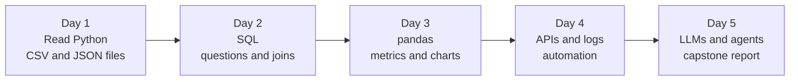
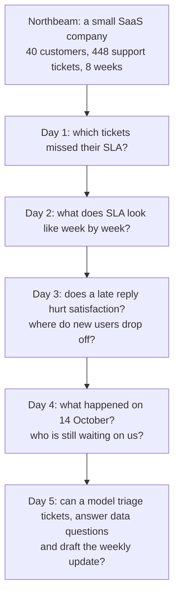
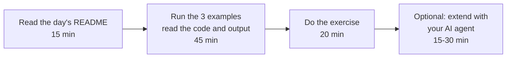
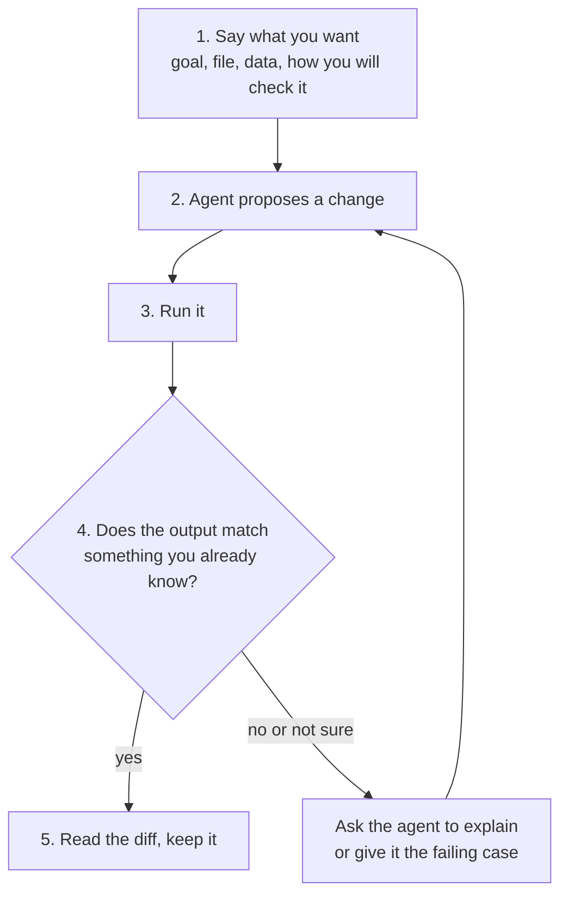

# Python in 5 days

A hands-on study plan for people who work in **technical support, escalations, data analytics and program or product management**, and who will let an **AI coding agent write most of the code**.

- You already know what a condition and a loop are. That is enough.
- You do **not** drill syntax here. You learn to **read** Python, **run** it, **judge** the result and **steer** an agent.
- Every example is a job you could be asked to do on Monday: an SLA report, an outage investigation, a product funnel, an escalation list.
- Everything runs on your laptop, offline, for free. No API key is needed, not even on the AI day.

## The plan

| Day | Topic | After this day you can ... | Time | Open |
|---|---|---|---|---|
| 1 | Read Python, work with files | read a script, load CSV and JSON, find SLA breaches | 75-105 min | [Day 1](day1_python_foundations/README.md) |
| 2 | SQL | ask a database questions, join tables, build a weekly SLA report | 80-110 min | [Day 2](day2_sql/README.md) |
| 3 | Data analysis with pandas | summarise, pivot and chart support and product data | 80-110 min | [Day 3](day3_data_analysis/README.md) |
| 4 | APIs, logs, automation | pull data from an API, find an incident in a log, automate a report | 85-115 min | [Day 4](day4_apis_logs_automation/README.md) |
| 5 | LLMs and agentic workflows | classify tickets with a model, build an agent with tools and guardrails | 85-120 min | [Day 5](day5_llm_agents/README.md) |

Each day fits in 1 to 2 hours. The lower number is the core path. The higher number includes the optional agent prompts.

## Roadmap



Day 5 reuses the earlier days: SQL from Day 2 becomes the agent's tool, and pandas from Day 3 computes the numbers for the capstone report.

The same fictional company runs through all five days, so each day adds a new tool to a story you already know:



## Set up (once, about 10 minutes)

You need **Python 3.11 or newer** ([python.org/downloads](https://www.python.org/downloads/)) and git.

macOS or Linux:

```bash
git clone https://github.com/barna0103/python.git
cd python
python3 -m venv .venv
source .venv/bin/activate
python -m pip install -r requirements.txt
python check_setup.py
```

Windows (PowerShell):

```powershell
git clone https://github.com/barna0103/python.git
cd python
py -m venv .venv
.venv\Scripts\Activate.ps1
python -m pip install -r requirements.txt
python check_setup.py
```

- `.venv` is a private folder of Python packages for this project only. Nothing is installed system-wide.
- `check_setup.py` runs all 25 scripts of the course. If it ends with `All 25 scripts ran`, you are ready.
- Each time you open a new terminal, activate again (`source .venv/bin/activate` or `.venv\Scripts\Activate.ps1`).
- Days 1 and 2 use only what ships with Python. The four packages in [requirements.txt](requirements.txt) are for Days 3 to 5.

## How to run things

Run every script from the repository folder, like this:

```bash
python day1_python_foundations/01_reading_python.py
```

- Scripts are numbered. Run them in order.
- Files a script creates go into an `output/` folder next to it. You can delete those folders at any time.
- Nothing can break. The data in `data/` is only ever read. If you change it by accident: `git checkout data/`.

## How each day works



Every day's README has the same sections: goal, time plan, the big picture as a diagram, key ideas in plain English, three worked examples, a real-life scenario, a small dose of object-oriented Python, an exercise with a solution, and prompts for your AI agent.

## Working with an AI coding agent

This is how you will really work, so practise it from Day 1.



A prompt that works has four parts:

| Part | Example |
|---|---|
| Context | "Look at `day1_python_foundations/03_sla_breaches.py` and `data/tickets.csv`." |
| Task | "Add a breakdown of breaches by category." |
| Limits | "Standard library only. Keep the existing output." |
| Check | "The total must still be 77 breaches." |

Before you accept a change, ask yourself:

- Did I run it, and does at least one number match something I can verify by hand?
- Can I say in one sentence what each new block does? If not, ask the agent to explain it.
- Did it add a new package or touch files I did not mention? Why?
- What happens with empty values, an unanswered ticket, a missing file?

Each day ends with ready-made prompts for exactly this.

## The sample data

All in [data/](data/). Fictional, generated by [scripts/generate_data.py](scripts/generate_data.py) with a fixed seed.

| File | What it is | Used on |
|---|---|---|
| `tickets.csv` | 448 support tickets over 8 weeks (7 Sep to 1 Nov 2026) | every day |
| `customers.csv` | 40 companies with plan, region and monthly revenue | Days 1-5 |
| `agents.csv` | 8 support agents in 3 teams | Days 2, 4, 5 |
| `sla_policy.json` | first-response and resolution targets per priority | Days 1-3, 5 |
| `product_events.csv` | 692 product usage events from 196 users | Day 3 |
| `app.log` | 1,045 application log lines from 13-14 October | Day 4 |
| `ticket_messages.json` | 12 free-text tickets with a human-chosen label | Day 5 |

- "Now" is fixed at **2 November 2026, 09:00** in every script, so your numbers match the ones in the guides.
- There is a login outage hidden in the data on 14 October. You will meet it from a different angle each day.

## Just enough object-oriented Python

No theory chapter. Each day shows one idea, in code you are already running.

| Day | Idea | Where you see it |
|---|---|---|
| 1 | An object is a value with built-in abilities: `value.method()` | text, dates, a small `Ticket` class |
| 2 | Some objects hold a live resource | the database connection |
| 3 | Methods can be chained, each returns a new object | `tickets.groupby(...).agg(...).round(2)` |
| 4 | Reading a whole class: `__init__`, `self`, methods | `HelpdeskClient` |
| 5 | Two classes with the same methods are interchangeable | `MockLLM` and `ClaudeLLM` |

## Using a real LLM on Day 5 (optional)

Day 5 works offline with a rule-based stand-in called `MockLLM`. To use a real model instead:

1. Get an API key from [console.anthropic.com](https://console.anthropic.com/). Calls cost money: one full run of Day 5 makes roughly 20 to 30 short calls, so check the current pricing first.
2. Set it in your terminal, then run the Day 5 scripts as usual.

```bash
export ANTHROPIC_API_KEY="sk-ant-..."        # Windows PowerShell: $env:ANTHROPIC_API_KEY="sk-ant-..."
python day5_llm_agents/01_classify_tickets.py
```

- Back to offline: close the terminal, or set `LLM_MODE=mock`.
- Never put a key in a file you commit. Details are in the [Day 5 guide](day5_llm_agents/README.md#switching-to-a-real-model).

## Only have 4 days?

Do Days 1, 2, 3 and 5. Day 5 does not depend on Day 4. Come back to Day 4 when you first need to pull data from an API or read a log file.

## What is in this repository

```text
README.md                      this page
requirements.txt               the 4 pinned packages
check_setup.py                 runs every script to check your setup
data/                          sample data shared by all days
scripts/generate_data.py       how the sample data was made (optional reading)
day1_python_foundations/       README.md, 3 examples, exercise.py, solutions/
day2_sql/                      README.md, 3 examples, exercise.py, solutions/, queries/
day3_data_analysis/            README.md, 3 examples, exercise.py, solutions/, images/
day4_apis_logs_automation/     README.md, 3 examples, exercise.py, solutions/
day5_llm_agents/               README.md, 3 examples, exercise.py, solutions/
```

## If something goes wrong

| You see | Do this |
|---|---|
| `python: command not found` | Use `python3` (macOS, Linux) or `py` (Windows). |
| `ModuleNotFoundError: No module named 'pandas'` | Activate `.venv`, then `python -m pip install -r requirements.txt`. |
| `Activate.ps1 cannot be loaded` (Windows) | Run `Set-ExecutionPolicy -Scope Process RemoteSigned`, then activate again. |
| `No such file or directory` when running a script | Run from the repository folder (where this README is). |
| Numbers differ from the guide | You probably edited a file in `data/`. Restore with `git checkout data/`. |
| Any other error | Paste the full error text to your AI agent and ask what it means. That is a normal way to work. |

## After Day 5

- Point one script at your own export: a real ticket CSV, a real log file.
- Ask your agent to turn a script into a notebook (Jupyter) if you prefer to explore step by step.
- Schedule a report (cron, Windows Task Scheduler or GitHub Actions) so it runs without you.
