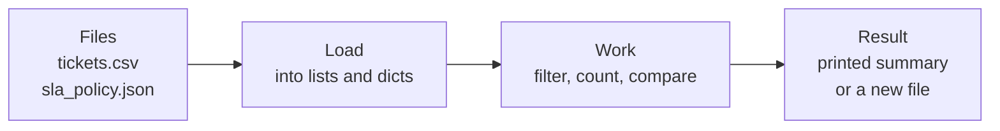
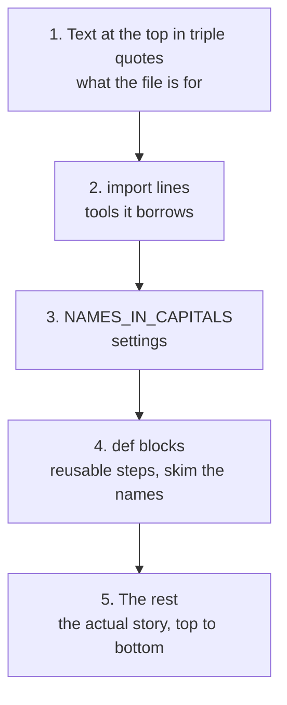
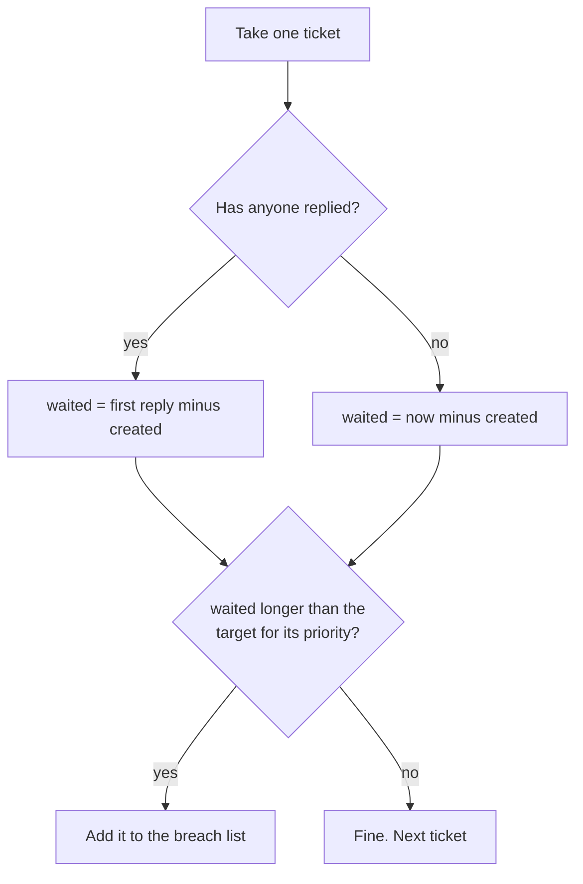
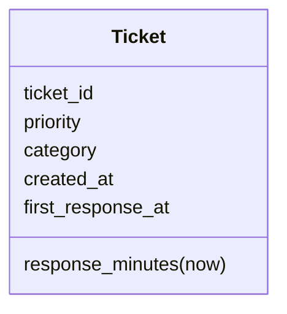

# Day 1: Read Python and work with data files

[Back to the plan](../README.md) | Next: [Day 2 - SQL](../day2_sql/README.md)

## Goal

By the end of today you can open a Python script, say what it does, run it, and use it to answer a real question from a ticket export: **which tickets missed their first-response SLA?**

## Why it matters

| Role | What today gives you |
|---|---|
| Technical support | Answer "how many, which ones, how late" from an export in seconds instead of filtering a spreadsheet by hand. |
| Escalation | A repeatable breach list you can trust, because you can read how it was built. |
| Data analytics | The data shapes (rows, records, lookups) that every later tool builds on. |
| Program / product | Enough reading skill to review what an engineer or an AI agent hands you. |

## Time plan (75 minutes, up to 105 with the optional part)

| Step | Minutes |
|---|---|
| Read this page | 15 |
| Example 1: reading Python | 15 |
| Example 2: ticket counts | 10 |
| Example 3: SLA breaches | 20 |
| Exercise | 15 |
| Optional: extend with your AI agent | 30 |

## The big picture

Almost every data script has the same three stages.



And almost every Python file is laid out the same way. Read it in this order:



## Key ideas in plain English

**Data shapes**

- A **list** is an ordered collection: `["P1", "P2", "P3"]`.
- A **dict** is one labelled record: `{"ticket_id": "T0001", "priority": "P1"}`.
- A **list of dicts is a table**. Each dict is a row. This shape is what CSV files, JSON and API replies all turn into.

**Files**

- **CSV** is a table as text. One line per row. Everything arrives as text, so numbers must be converted before you do maths.
- **JSON** is nested data as text. It maps straight onto Python dicts and lists. Good for settings and API replies.

**Code**

- A **function** (`def`) is a named, reusable step. You give it inputs, it gives back a result.
- An **import** borrows ready-made tools. `csv`, `json`, `datetime` ship with Python.
- A **comprehension** builds a list in one line. Read it right to left.

**Reading cheat sheet**

| You see | Read it as |
|---|---|
| `x = 5` | the name `x` now points at 5 |
| `[a, b, c]` | a list |
| `{"key": value}` | a dict |
| `row["priority"]` | look up `priority` in `row` |
| `tickets[0]`, `tickets[-1]` | first item, last item |
| `text.lower()` | ask `text` to do something it knows how to do |
| `for row in tickets:` | do the indented block once per row |
| `if x > 10:` | do the indented block only when true |
| `def name(inputs):` | define a reusable step |
| `f"{count} late"` | text with a value dropped in |
| `[r for r in rows if r["status"] == "open"]` | new list: every `r` in `rows` where the condition holds |
| `with open(path) as handle:` | open a file, close it automatically afterwards |
| `None` | "no value" |
| `# ...` | a note for humans, ignored by Python |

Indentation is not decoration. It shows which lines belong to a loop, a condition or a function.

## Worked examples

### Example 1: a guided tour ([01_reading_python.py](01_reading_python.py))

```bash
python day1_python_foundations/01_reading_python.py
```

Nine short blocks, each printing one numbered line. For each block: read, predict, then check the output.

```python
late_ids = [row["ticket_id"] for row in tickets if breached_sla(row, 15)]
```

- Read it as: "for each row in tickets, if it breached a 15 minute target, keep its ticket id".
- Output line 7 is `late tickets: ['T0001', 'T0002']`.

### Example 2: quick counts from a ticket export ([02_ticket_counts.py](02_ticket_counts.py))

```bash
python day1_python_foundations/02_ticket_counts.py
```

- `csv.DictReader` turns each CSV line into a dict. The column headers become the keys.
- `Counter` is "group and count" in one word.
- Filter first, then count: that is how you get "unresolved tickets by priority".

```text
Tickets by priority
  P3            200
  P4            122
  P2            100
  P1             26
```

Notice the three busiest days. One of them, 14 October, has 47 tickets. The next busiest day has 11. Remember that date.

### Example 3: which tickets missed their SLA? ([03_sla_breaches.py](03_sla_breaches.py))

```bash
python day1_python_foundations/03_sla_breaches.py
```

- Reads the targets from `sla_policy.json` (P1: 15 minutes ... P4: 480 minutes).
- Turns the text `2026-10-14 09:24:26` into a real date-time, so two of them can be subtracted.
- Compares each ticket's waiting time with the target for its priority.
- Prints a summary and saves the full list to `output/sla_breaches.csv`.

```text
First-response SLA breaches: 77 (17.2%)

Priority    Target  Tickets  Breached    Rate
P1            15m       26        10     38%
P2            60m      100        26     26%
P3           240m      200        29     14%
P4           480m      122        12     10%
```

Keep the number **77** in mind. You will get it again with SQL on Day 2 and with pandas on Day 3. Three tools, one answer: that is how you know a metric is right.

## Real-life scenario: the Monday SLA review

The support lead opens Monday's meeting with: "How did we do on first response, and where did we miss?"



- This is exactly what the loop in example 3 does.
- The "no reply yet" branch matters. Ticket T0448 has waited 1,301 minutes with no answer. A script that skips empty values would hide your worst case.
- "Now" is read from `sla_policy.json` so the report gives the same answer every time it runs. A real script would use the current time.

## Just enough OOP: objects and a first class

- An **object** is a value that carries its own abilities. You use them with a dot: `subject.lower()`, `path.read_text()`, `counter.most_common(3)`.
- A **class** is the template. Each ticket built from it is an object.
- Example 3 defines one small class with `@dataclass`, which writes the boring parts for you:

```python
@dataclass
class Ticket:
    ticket_id: str
    priority: str
    category: str
    created_at: datetime
    first_response_at: datetime | None

    def response_minutes(self, now):
        answered = self.first_response_at or now
        return (answered - self.created_at).total_seconds() / 60
```



- The top part is the data each ticket holds. The bottom part is what a ticket can do.
- `self` means "this particular ticket".
- You use it as `ticket.priority` and `ticket.response_minutes(now)`. Compare with `row["priority"]` in example 2: same idea, but a typo in a field name is caught immediately.

That is all the OOP you need today: **dot means "ask the object"**.

## Exercise: the escalation hot list (15 minutes)

Your manager asks: "Which 5 customers had the most escalated tickets? Company name and plan, please."

1. Open [exercise.py](exercise.py). Loading is done. Two `TODO`s are left.
2. Run it: `python day1_python_foundations/exercise.py`. It tells you nothing is counted yet.
3. Fill in the TODOs yourself, or give the first prompt below to your agent.
4. Check: there are **41** escalated tickets in total, across 24 customers.
5. Compare with [solutions/exercise_solution.py](solutions/exercise_solution.py).

## Prompts for your AI agent

Copy, adjust, and always run the result.

1. **Do the exercise.** "In `day1_python_foundations/exercise.py`, fill in the two TODOs. Standard library only, keep the existing loading code. The escalated tickets must add up to 41. Then explain each line you added in one sentence."
2. **Explain before you trust.** "Explain `day1_python_foundations/03_sla_breaches.py` to me block by block, in plain English, as if I know loops and conditions but not classes. Do not change the file."
3. **Extend the report.** "In `03_sla_breaches.py`, add a table of breaches by category, sorted worst first, with the breach rate per category. The overall total must still be 77."
4. **Add a second SLA.** "`data/sla_policy.json` also has `resolution_hours`. Add a resolution-SLA check to a copy of `03_sla_breaches.py`. Decide how to treat tickets that are still unresolved and tell me what you chose and why."
5. **Make it reusable.** "Change `03_sla_breaches.py` so I can pass a different tickets file on the command line. Keep `data/tickets.csv` as the default."
6. **Review it.** "Review `03_sla_breaches.py` for edge cases: empty values, a priority missing from the policy, zero tickets. List the risks first. Do not fix anything yet."

## Check yourself

<details>
<summary>1. What shape is <code>tickets</code> after <code>list(csv.DictReader(handle))</code>?</summary>

A list of dicts. One dict per row, keyed by column name. All values are text.
</details>

<details>
<summary>2. Why does example 2 write <code>int(row["csat"])</code>?</summary>

CSV values are always text. `int(...)` converts `"4"` into the number 4 so it can be averaged.
</details>

<details>
<summary>3. In <code>ticket.response_minutes(now)</code>, what is <code>ticket</code> and what is <code>response_minutes</code>?</summary>

`ticket` is an object built from the `Ticket` class. `response_minutes` is a method: a function that belongs to it.
</details>

<details>
<summary>4. Why is "now" fixed instead of the real current time?</summary>

So the report is repeatable: the same input always gives the same 77 breaches. In production you would use the real time.
</details>

## Next

[Day 2 - SQL](../day2_sql/README.md): the same questions, asked of a database, with joins across customers and agents.
