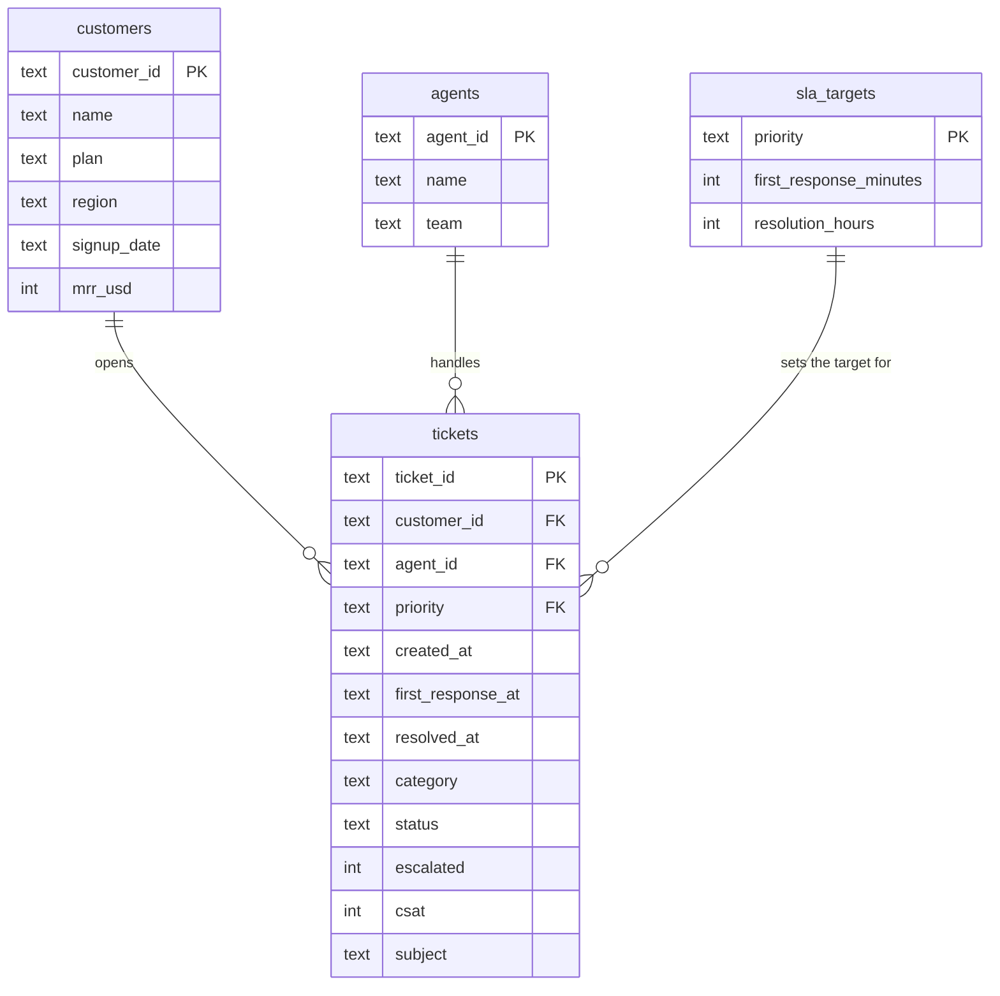
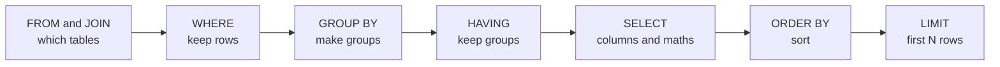
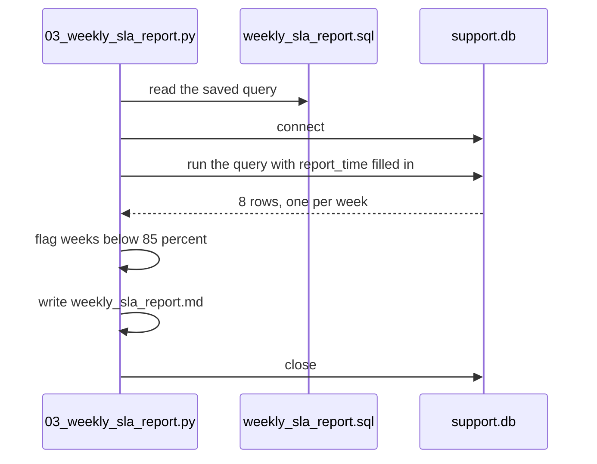

# Day 2: SQL - ask questions of your data

[Back to the plan](../README.md) | Previous: [Day 1](../day1_python_foundations/README.md) | Next: [Day 3 - pandas](../day3_data_analysis/README.md)

## Goal

By the end of today you can read a SQL query, change it, and run it from Python to produce a **weekly SLA report** that joins tickets, customers and agents.

## Why it matters

| Role | What today gives you |
|---|---|
| Technical support | Pull "all open P1 tickets for this customer" yourself instead of waiting for someone. |
| Escalation | Join tickets to customers and agents: who is affected, on which plan, owned by whom. |
| Data analytics | SQL is the shared language of every warehouse and BI tool. This is the most transferable skill of the week. |
| Program / product | Check a metric's definition by reading the query behind the dashboard. |

AI agents write SQL well. Your job is to read it and spot the wrong join, the missing filter or the misleading average.

## Time plan (80 minutes, up to 110 with the optional part)

| Step | Minutes |
|---|---|
| Read this page | 15 |
| Example 1: build the database | 10 |
| Example 2: eight query patterns | 25 |
| Example 3: weekly SLA report | 15 |
| Exercise | 15 |
| Optional: extend with your AI agent | 30 |

## The big picture

Yesterday's CSV files become four tables that point at each other.



- **PK** (primary key): the column that identifies a row.
- **FK** (foreign key): a column that points at a row in another table. A `JOIN` follows that pointer.
- One customer has many tickets. That is what the forked line means.

A query is written in one order but worked out in another. Reading it in this order makes any query easier:



## Key ideas in plain English

| SQL | Plain English | Spreadsheet equivalent |
|---|---|---|
| `SELECT a, b` | show these columns | hide the other columns |
| `FROM tickets` | from this table | pick the sheet |
| `WHERE status = 'open'` | only rows that match | filter |
| `ORDER BY created_at DESC` | sort, newest first | sort |
| `LIMIT 5` | first 5 rows only | - |
| `GROUP BY category` | one result row per category | pivot table rows |
| `COUNT(*)`, `SUM()`, `AVG()` | summarise each group | pivot table values |
| `HAVING COUNT(*) >= 10` | only groups that match | filter on the pivot |
| `JOIN customers ON ...` | look up matching rows in another table | VLOOKUP / XLOOKUP |
| `CASE WHEN ... THEN 1 ELSE 0 END` | an if/else inside a query | IF() |
| `WITH name AS (...)` | a named intermediate step | a helper sheet |
| `LAG(x) OVER (ORDER BY week)` | the value of `x` in the previous row | a cell reference to the row above |

Four things that catch people out:

- **NULL means "no value"**. `AVG(csat)` ignores tickets without a score. `COUNT(*)` counts rows, `COUNT(csat)` counts only rows that have a score.
- **`WHERE` filters rows, `HAVING` filters groups.** "Agents with at least 10 rated tickets" is a `HAVING`.
- **A JOIN can multiply rows.** If the result has more rows than you expected, check the `ON` condition first.
- **Values go in through placeholders** (`?` or `:name`), never glued into the query text. That keeps odd characters and attackers out.

SQLite, used today, is a real SQL database in a single file. It ships with Python. What you learn carries over to PostgreSQL, MySQL, Snowflake and BigQuery with small differences, mostly in date functions.

## Worked examples

### Example 1: CSV files become a database ([01_build_database.py](01_build_database.py))

```bash
python day2_sql/01_build_database.py
```

- Creates `output/support.db` from the CSV and JSON files.
- The loading code is in [support_db.py](support_db.py): `CREATE TABLE` statements, then one `INSERT` per row.
- Empty CSV cells become `NULL`.
- Shows how to ask a database what it contains, which is the first thing to do with one you inherit.

### Example 2: eight patterns that answer most questions ([02_sql_basics.py](02_sql_basics.py))

```bash
python day2_sql/02_sql_basics.py
```

Each block prints the SQL, then its result. Read the query, predict, check.

| # | Pattern | Question it answers |
|---|---|---|
| 1 | `SELECT ... LIMIT` | What does the data look like? |
| 2 | `WHERE` | Which urgent tickets are unresolved? |
| 3 | `ORDER BY` | What are the newest escalations? |
| 4 | `GROUP BY` + `COUNT` | How many tickets per category? |
| 5 | several summaries | Which category has the worst satisfaction? |
| 6 | `JOIN` | How do plans compare? |
| 7 | calculated column | How fast do we reply, per priority? |
| 8 | parameter | What are this customer's latest tickets? |

Pattern 6, the join, is the one to study:

```sql
SELECT c.plan,
       COUNT(*)                       AS tickets,
       COUNT(DISTINCT t.customer_id)  AS customers,
       ROUND(AVG(t.csat), 2)          AS avg_csat
FROM tickets AS t
JOIN customers AS c ON c.customer_id = t.customer_id
GROUP BY c.plan
ORDER BY tickets DESC
```

- `t` and `c` are short nicknames for the tables.
- `ON c.customer_id = t.customer_id` says how a ticket finds its customer.
- Result: Enterprise customers are 10 of 40 companies but open 198 of 448 tickets.

### Example 3: the weekly SLA report ([03_weekly_sla_report.py](03_weekly_sla_report.py))

```bash
python day2_sql/03_weekly_sla_report.py
```

The query lives in its own file, [queries/weekly_sla_report.sql](queries/weekly_sla_report.sql), in three named steps:

1. `ticket_sla`: one row per ticket with its week and a 1 or 0 for "breached".
2. `weekly`: roll those up to one row per week.
3. Final `SELECT`: add the change against the week before with `LAG`.

```text
week_start  tickets  change_vs_prev_week  escalated  breached  sla_met_pct  avg_csat
----------  -------  -------------------  ---------  --------  -----------  --------
2026-09-07  56                            5          14        75.0         3.94
2026-09-14  48       -8                   3          4         91.7         4.38
2026-09-21  49       1                    5          4         91.8         4.37
2026-09-28  52       3                    2          4         92.3         4.0
2026-10-05  53       1                    3          10        81.1         4.17
2026-10-12  93       40                   17         29        68.8         3.6
2026-10-19  48       -45                  3          7         85.4         4.25
2026-10-26  49       1                    3          5         89.8         4.17
```

- Add up the `breached` column: **77**. The same number as Day 1, from a different tool.
- The week of 12 October stands out: nearly double the tickets, the lowest SLA and the lowest satisfaction.
- The script also writes `output/weekly_sla_report.md`, ready to paste into a document.

## Real-life scenario: the weekly SLA report

Every Monday the support lead needs volume, SLA compliance and satisfaction per week. The team's promise is 85% of first replies in time.



- The question is saved in a `.sql` file, so it is identical every week and anyone can review the definition of "breached".
- Python does the parts SQL is poor at: reading files, deciding what to flag, writing the report.
- Three of the eight weeks miss the 85% goal. That sentence is what the support lead actually wants.

## Just enough OOP: objects that hold a connection

From example 3:

```python
conn = connect()
cursor = conn.execute(sql, {"report_time": REPORT_TIME})
rows = cursor.fetchall()
conn.close()
```

- `conn` is an object that holds the open database. `conn.execute(...)` asks it to run a query.
- `cursor` is the result. `cursor.fetchall()` asks it for all rows.
- Each row can be read by column name: `row["tickets"]`.
- `conn.close()` gives the database back.

What to take away:

- Same rule as Day 1: **dot means "ask the object"**.
- New today: some objects hold a live resource (a file, a database, a network connection). They need closing when you are done.
- You will meet the same shape on Day 4 (an API session) and Day 5 (an LLM client).

## Exercise: the agent leaderboard (15 minutes)

The support lead asks: "Per agent: tickets handled, escalations, average satisfaction. Best score first. Leave out anyone with fewer than 10 rated tickets."

1. Open [exercise.py](exercise.py). The query only lists the agents so far.
2. Run it: `python day2_sql/exercise.py`.
3. Extend `QUERY`. You need `JOIN`, `GROUP BY`, `COUNT`, `SUM`, `AVG`, `HAVING`, `ORDER BY`.
4. Check: you should get 7 agents (one has too few rated tickets), and their ticket counts should add up to 432.
5. Compare with [solutions/exercise_solution.py](solutions/exercise_solution.py).
6. Think: is the top agent really "the best"? What else differs between agents?

## Prompts for your AI agent

1. **Do the exercise.** "In `day2_sql/exercise.py`, extend `QUERY` to show per agent: tickets, escalated tickets, rated tickets and average csat, best csat first, only agents with at least 10 rated tickets. SQLite syntax. Then explain the difference between WHERE and HAVING using this query."
2. **Explain a query.** "Explain `day2_sql/queries/weekly_sla_report.sql` step by step in plain English. What does `date(created_at, 'weekday 0', '-6 days')` do? What would change if I removed COALESCE?"
3. **New question.** "Add a query to `day2_sql/02_sql_basics.py`: the 5 customers with the most SLA breaches, with their plan and breach count. Reuse the breach definition from `queries/weekly_sla_report.sql`. The breaches across all customers must total 77."
4. **Slice the report.** "Create `queries/weekly_sla_by_plan.sql`: the weekly SLA report split by customer plan. Add a small script that runs it and prints the result with `format_table` from `support_db.py`."
5. **Resolution SLA.** "Add a resolution-time SLA to the weekly report using `sla_targets.resolution_hours`. Tell me how you treat unresolved tickets and why."
6. **Review it.** "Review `queries/weekly_sla_report.sql` as a sceptical analyst. Where could the numbers mislead? Think about NULLs, time zones, weeks with few rated tickets. List the issues. Do not change the file."

## Check yourself

<details>
<summary>1. What is the difference between <code>COUNT(*)</code> and <code>COUNT(csat)</code>?</summary>

`COUNT(*)` counts rows. `COUNT(csat)` counts only rows where `csat` has a value (is not NULL).
</details>

<details>
<summary>2. Why does the report use <code>COALESCE(t.first_response_at, :report_time)</code>?</summary>

A ticket nobody has answered has no first-response time. `COALESCE` swaps in the report time, so the ticket is measured as "still waiting" instead of being silently dropped.
</details>

<details>
<summary>3. Your join returns more rows than the tickets table has. What do you check?</summary>

The `ON` condition. A missing or wrong condition matches each ticket to several rows in the other table.
</details>

<details>
<summary>4. Why keep the query in a <code>.sql</code> file instead of inside the Python script?</summary>

It can be reviewed, reused and opened in any database tool. The definition of the metric lives in one place.
</details>

## Next

[Day 3 - Data analysis with pandas](../day3_data_analysis/README.md): the same data as one in-memory table, plus charts and a product funnel.
