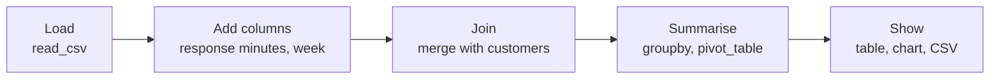
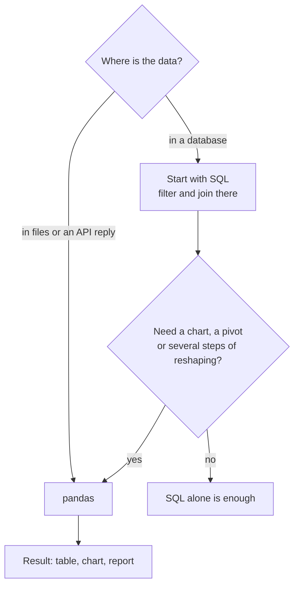
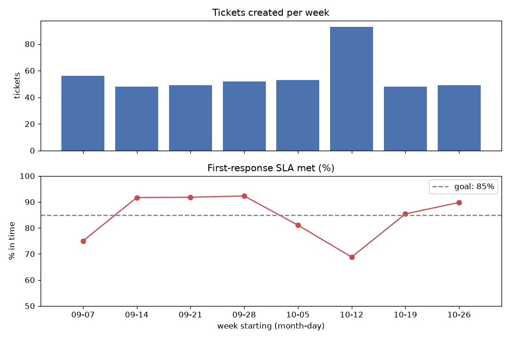
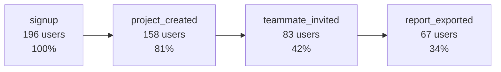
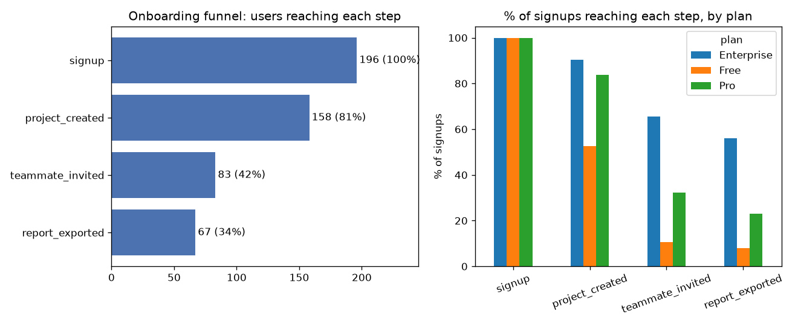

# Day 3: Data analysis with pandas and charts

[Back to the plan](../README.md) | Previous: [Day 2](../day2_sql/README.md) | Next: [Day 4 - APIs, logs, automation](../day4_apis_logs_automation/README.md)

## Goal

By the end of today you can load a table with pandas, summarise it, join it to another table, draw a chart, and answer two classic questions: **are we meeting SLA for every customer segment?** and **where do new users drop off?**

## Why it matters

| Role | What today gives you |
|---|---|
| Technical support | Trends instead of anecdotes: "Login tickets doubled that week" with a chart to show it. |
| Escalation | Size the impact of an incident in numbers: volume, reply time, satisfaction. |
| Data analytics | pandas is the standard tool for analysis in Python. Most AI-written analysis code uses it. |
| Program / product | Funnels, conversion by plan, weekly active users: the core of product analytics. |

## Time plan (80 minutes, up to 110 with the optional part)

| Step | Minutes |
|---|---|
| Read this page | 15 |
| Example 1: explore a table | 15 |
| Example 2: support metrics and a chart | 20 |
| Example 3: product funnel | 15 |
| Exercise | 15 |
| Optional: extend with your AI agent | 30 |

Today needs the packages from `requirements.txt`. If `import pandas` fails, see [setup](../README.md#set-up-once-about-10-minutes).

## The big picture

Nearly every analysis follows the same five steps. Look for them in each example.



Which tool for which job?



## Key ideas in plain English

- A **DataFrame** is a table in memory. By habit it is called `df` or named after its content, like `tickets`.
- A **Series** is one column: `tickets["priority"]`.
- **Whole-column maths.** `tickets["resolved_at"] - tickets["created_at"]` subtracts every row at once. No loop.
- **Missing values** show as `NaN` (numbers) or `NaT` (dates). `mean()` skips them, like `AVG` in SQL.
- **Filter** with a condition in square brackets: `tickets[tickets["status"] != "resolved"]`.
- **`groupby` + `agg`** is `GROUP BY`. **`merge`** is `JOIN`. **`pivot_table`** is a spreadsheet pivot table.
- **Charts** come from matplotlib. The scripts save PNG files, so nothing needs to pop up on screen.

The same question in the two languages you now know:

| Question | SQL (Day 2) | pandas (today) |
|---|---|---|
| Only open tickets | `WHERE status = 'open'` | `tickets[tickets["status"] == "open"]` |
| Tickets per category | `GROUP BY category` + `COUNT(*)` | `tickets["category"].value_counts()` |
| Average score per category | `GROUP BY category` + `AVG(csat)` | `tickets.groupby("category")["csat"].mean()` |
| Add customer details | `JOIN customers ON ...` | `tickets.merge(customers, on="customer_id")` |
| Sort | `ORDER BY avg_csat` | `.sort_values("avg_csat")` |
| First rows | `LIMIT 5` | `.head(5)` |

## Worked examples

### Example 1: explore a table you have never seen ([01_explore_tickets.py](01_explore_tickets.py))

```bash
python day3_data_analysis/01_explore_tickets.py
```

A five-minute routine for any new dataset:

1. `tickets.shape`: how many rows and columns?
2. `tickets.head(3)`: look at real rows.
3. `tickets.isna().sum()`: where are values missing? Here: 1 ticket without a first reply, 21 unresolved, 187 without a satisfaction score.
4. `value_counts()`: what values does a column hold?
5. Filter: the unresolved P1 and P2 tickets.
6. `groupby(...).agg(...)`: one summary row per category.

```python
by_category = (
    tickets.groupby("category")
    .agg(
        tickets=("ticket_id", "count"),
        escalated=("escalated", "sum"),
        avg_csat=("csat", "mean"),
    )
    .round(2)
    .sort_values("avg_csat")
)
```

- Read `tickets=("ticket_id", "count")` as: "a result column called `tickets`, made by counting `ticket_id`".
- Login has the lowest satisfaction (3.33) and the most escalations (19).

### Example 2: support metrics, a pivot table and a chart ([02_support_metrics.py](02_support_metrics.py))

```bash
python day3_data_analysis/02_support_metrics.py
```

Three leadership questions, answered with the five steps above.

```text
1. SLA and satisfaction by plan
            tickets  median_response_min  sla_met_pct  avg_csat
plan
Enterprise      198                 83.7         91.9       4.2
Free             56                181.2         66.1       3.9
Pro             194                125.5         78.4       4.0

2. Satisfaction: in time vs late
                  mean  count
answered in time  4.29    217
answered late     2.86     44
```

- The first line of output says `SLA breaches: 77`. Third tool, same answer.
- Free customers get an in-time reply 66% of the time, Enterprise 92%. Is that a decision or an accident? Good question for a product manager.
- Tickets answered late score 2.86 against 4.29. Careful: the outage tickets were both late and unhappy for another reason. A gap like this starts an investigation. It does not prove a cause.

The chart it saves to `output/weekly_support_metrics.png`:



### Example 3: a product funnel ([03_product_funnel.py](03_product_funnel.py))

```bash
python day3_data_analysis/03_product_funnel.py
```

- The input is an **event log**: one row each time a user does something (`signup`, `project_created`, `teammate_invited`, `report_exported`).
- The funnel counts how many different users reached each step: `events.groupby("event_name")["user_id"].nunique()`.



- The biggest drop is at **inviting a teammate**: only 52.5% of users who created a project go on to invite someone.
- By plan the picture is sharper: 65.5% of Enterprise signups invite a teammate, 10.5% of Free signups do.



## Real-life scenario: the quarterly business review

Leadership wants one slide on support health and one on onboarding.

- **Support slide.** Weekly volume with the SLA line underneath (the chart from example 2), plus one sentence: "First-response SLA was met for 69% of tickets in the outage week, against 75% to 92% in the other weeks."
- **Onboarding slide.** The funnel, plus: "Almost half of the users who create a project never invite a teammate. On the Free plan it is 4 in 5."
- **Your value** is the sentence, not the chart. The code gets you to the sentence in minutes and lets you re-run it next quarter.

## Just enough OOP: chaining methods

```python
tickets.groupby("category").agg(...).round(2).sort_values("avg_csat")
```

- Each method returns a **new object**, so the next method can be called on it straight away. Read a chain left to right, one step per dot.
- Long chains are wrapped in brackets and split over lines, one step per line.
- No brackets means a fact: `tickets.shape`. Brackets mean an action: `tickets.head()`.
- `.dt` and `.str` open a toolbox for a column type: `tickets["created_at"].dt.hour`, `tickets["subject"].str.lower()`.

## Exercise: how much did the outage hurt? (15 minutes)

The VP of Support asks: "Compared with a normal day, how did Login tickets from 14 October do on reply time and satisfaction?"

1. Open [exercise.py](exercise.py). Loading and the `day_type` column are done.
2. Run it: `python day3_data_analysis/exercise.py`. It reports 92 Login tickets, 39 from the outage day.
3. Fill in the TODO: one row per `day_type` with ticket count, median response minutes, average csat and escalations.
4. Check: satisfaction should come out at 2.7 for the outage day against 3.9 for normal days.
5. Compare with [solutions/exercise_solution.py](solutions/exercise_solution.py).
6. Think: the outage tickets were answered *faster* (median 55 minutes against 139). Why is that not good news? Hint: look at their priorities.

## Prompts for your AI agent

1. **Do the exercise.** "In `day3_data_analysis/exercise.py`, fill in the TODO with a groupby on `day_type`: ticket count, median `response_minutes`, mean `csat`, sum of `escalated`, rounded to 1 decimal. Explain the `.agg(...)` syntax you used."
2. **Translate.** "Rewrite question 1 of `day3_data_analysis/02_support_metrics.py` (SLA by plan) as a SQL query for the Day 2 database, and show that both give the same numbers."
3. **New chart.** "Add a chart to `02_support_metrics.py`: average csat per category as a horizontal bar chart, worst at the top, saved to `output/csat_by_category.png`. Use matplotlib only."
4. **Fairer comparison.** "In the exercise, outage tickets look fast because they were mostly P1 and P2. Compare each ticket's response time with its own SLA target instead, and show the percentage answered in time for outage day and normal days."
5. **Product question.** "Using `data/product_events.csv`, work out the median time from `signup` to `project_created` per plan. Explain how you handled users who never created a project."
6. **Retention.** "From `product_events.csv`, of the users who exported a report in one week, what share exported again the following week? Show it as a table per week and tell me the assumptions."
7. **Review it.** "Review `03_product_funnel.py`. Could a user be counted at a later step without having done an earlier one? How would I check that in this data?"

## Check yourself

<details>
<summary>1. What does <code>tickets[tickets["priority"] == "P1"]</code> return?</summary>

A new DataFrame with only the rows where priority is P1. The inner part makes a column of True/False values. The outer brackets keep the True rows.
</details>

<details>
<summary>2. Which pandas method is the equivalent of a SQL JOIN?</summary>

`merge`. For example `tickets.merge(customers, on="customer_id")`.
</details>

<details>
<summary>3. Why count <code>nunique()</code> users instead of rows in the funnel?</summary>

One user can trigger the same event many times, such as exporting several reports. A funnel asks how many different users reached a step.
</details>

<details>
<summary>4. Tickets answered late have lower satisfaction. Does being late cause it?</summary>

Not proven. The outage produced tickets that were late and unhappy for a shared reason. Compare within similar tickets, such as the same category and week, before you claim a cause.
</details>

## Next

[Day 4 - APIs, logs and automation](../day4_apis_logs_automation/README.md): stop exporting files by hand and find out what actually happened on 14 October.
