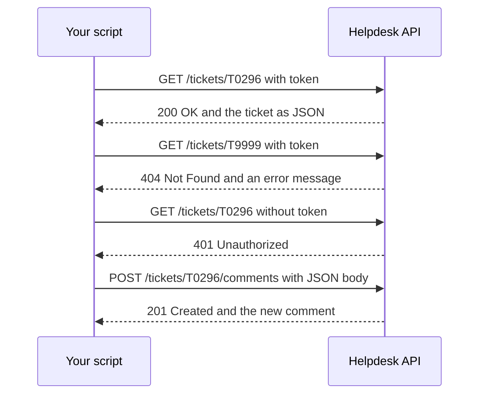
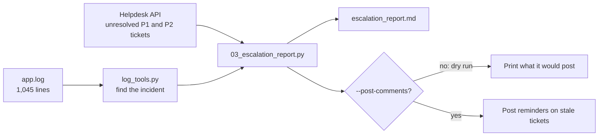
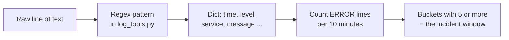
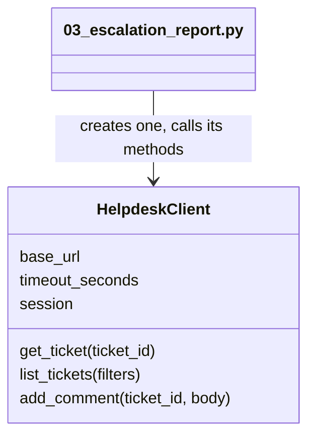

# Day 4: APIs, logs and automation

[Back to the plan](../README.md) | Previous: [Day 3](../day3_data_analysis/README.md) | Next: [Day 5 - LLMs and agents](../day5_llm_agents/README.md)

## Goal

By the end of today you can read code that calls a web API, pull structure out of a raw log file, and combine both into a report that **builds itself**: the daily escalation report.

## Why it matters

| Role | What today gives you |
|---|---|
| Technical support | Read API replies and status codes: half of "the integration is broken" tickets are a 401 or a 429. |
| Escalation | Find when an incident started, which service failed and who was hit, straight from the logs. |
| Data analytics | Most data now arrives through APIs as JSON, not as CSV exports. |
| Program / product | Know what "we can automate that" really involves, and what a safe automation looks like. |

Also: an LLM is called through an API. Today is the groundwork for tomorrow.

## Time plan (85 minutes, up to 115 with the optional part)

| Step | Minutes |
|---|---|
| Read this page | 15 |
| Example 1: call an API | 20 |
| Example 2: log analysis | 15 |
| Example 3: escalation report | 20 |
| Exercise | 15 |
| Optional: extend with your AI agent | 30 |

Everything runs offline. A small pretend helpdesk API ([mock_helpdesk_api.py](mock_helpdesk_api.py)) starts on your own computer when a script needs it.

## The big picture

An API call is a short conversation with a strict format.



Today's three examples build one pipeline:



## Key ideas in plain English

**APIs**

- An **API** is a way for programs to ask another system for data or to make a change. No screen, just requests and replies.
- A **request** has a URL, a method and often headers and parameters.
  - `GET` reads. `POST` creates. (`PUT`/`PATCH` change, `DELETE` removes.)
  - **Headers** carry who you are, usually a token.
  - **Parameters** say what you want: `?status=open&priority=P1`.
- A **reply** has a status code and usually a JSON body.
- **JSON** becomes Python dicts and lists. Nested data is read by chaining keys: `ticket["customer"]["plan"]`.
- **Pagination**: long lists arrive in pages. Keep asking for the next page until there is none.
- **Tokens are secrets.** They live in environment variables, never in code and never in git.

| Status code | Meaning | Usual cause |
|---|---|---|
| 200, 201 | OK, created | it worked |
| 400 | bad request | a required field is missing or malformed |
| 401 | unauthorized | missing, wrong or expired token |
| 403 | forbidden | valid token, but not allowed to do this |
| 404 | not found | wrong id or wrong URL |
| 429 | too many requests | rate limit: slow down and retry later |
| 500-599 | server error | their side is broken; retry, then escalate |

**Logs**

- A **log** is a file where software notes what it did, one line per event, with a time and a level (`INFO`, `WARN`, `ERROR`).
- A **regular expression** (regex) is a pattern that pulls named pieces out of text. AI agents write these well. You only need to recognise one and test it on a real line.

**Automation**

- **Command line flags** (`--min-age-days 14`) are knobs others can turn without editing code.
- **Dry run by default.** A script that changes things should show what it would do first and only act when told to.
- **Scheduling** (cron, Task Scheduler, GitHub Actions) is what turns a script into a report that arrives on its own.

## Worked examples

### Example 1: call an API step by step ([01_call_an_api.py](01_call_an_api.py))

```bash
python day4_apis_logs_automation/01_call_an_api.py
```

Six numbered steps: get one ticket, filter a list, handle errors, follow pages, post a comment, and (optionally) call a real public API.

```python
response = requests.get(f"{BASE_URL}/tickets/T0296", headers=HEADERS, timeout=10)
ticket = response.json()                         # JSON text -> Python dict
print("   customer:", ticket["customer"]["name"], f"({ticket['customer']['plan']})")
```

```text
1. GET /tickets/T0296
   status code: 200 (200 = OK)
   subject: Login page shows 'service unavailable'
   customer: Flint Hardware (Enterprise)
   assignee: David Kim - Escalations
```

- `timeout=10` means "give up after 10 seconds". Without it a script can hang forever.
- Step 4 collects 41 escalated tickets over 5 pages. Miss the loop and you silently report 10.
- Add `--live` to also call GitHub's public API. Same pattern, real internet.

To watch the server side, run `python day4_apis_logs_automation/mock_helpdesk_api.py` in a second terminal and open <http://127.0.0.1:8765/api/v1/health> in a browser.

### Example 2: find the incident in the log ([02_log_analysis.py](02_log_analysis.py))

```bash
python day4_apis_logs_automation/02_log_analysis.py
```

One raw line from `data/app.log`:

```text
2026-10-14T09:10:57Z ERROR auth-service request_id=b81b319d customer_id=C003 latency_ms=24258 msg="Token validation failed: upstream timeout"
```



```text
4. Incident window (10-minute buckets with 5 or more errors):
   from 2026-10-14 09:10:00 to 2026-10-14 11:40:00 (150 minutes)
   252 errors, 40 customers affected
   Services: auth-service (168), api-gateway (82), billing-service (1), report-worker (1)
   Top error messages:
      101  Token validation failed: upstream timeout
       82  POST /v1/login 503
       67  Database connection pool exhausted
```

- A normal day has 8 errors. The outage day has 257.
- Step 5 lines the errors up with new Login tickets, hour by hour. Errors stop at 11:40. Tickets keep arriving until 14:00.
- The detection rule (5 or more errors in 10 minutes) is a choice. Ask who decided it whenever you read an "incident detector".

### Example 3: the automated escalation report ([03_escalation_report.py](03_escalation_report.py))

```bash
python day4_apis_logs_automation/03_escalation_report.py
python day4_apis_logs_automation/03_escalation_report.py --min-age-days 14
python day4_apis_logs_automation/03_escalation_report.py --help
```

Four stages, marked in the code: **fetch** from the API, **enrich** with the log findings, **build** the Markdown report, **act** on stale tickets.

```text
- Unresolved P1/P2 tickets: **8**
- Stale (7+ days old): **5**
- By plan: Enterprise 5, Pro 2, Free 1

Stale tickets: 5
  [dry run] would comment on T0285: Automated reminder: this P1 ticket has been unresolved for 18 days. ...
Nothing was posted. Re-run with --post-comments to post for real.
```

- The report is saved to `output/escalation_report.md`. Open it.
- Four of the unresolved urgent tickets were opened on the outage day and are still open 18 days later. That is the headline.
- Add `--post-comments` to post the reminders. On the mock API this is safe to try.

## Real-life scenario: the morning after the outage

It is 15 October. Customers say "login was down yesterday". You are the escalation manager.

| Question from | You answer with | Answer |
|---|---|---|
| Engineering: "When exactly, and which service?" | Example 2 | 09:10 to 11:40 UTC, `auth-service`, upstream timeouts and an exhausted connection pool |
| Support lead: "How many tickets did it cause?" | Example 2, step 5 | 39 Login tickets that day, still arriving two hours after the fix |
| Account managers: "Who is still waiting?" | Example 3 and the exercise | 4 urgent outage tickets unresolved, 3 of them Enterprise customers |
| Leadership: "Can we get this every morning?" | Example 3 on a schedule | Yes: same script, run daily |

## Just enough OOP: reading a whole class

[helpdesk_client.py](helpdesk_client.py) is a typical small class. Every SDK you will ever use looks like this inside.

```python
class HelpdeskClient:
    def __init__(self, base_url, token, timeout_seconds=10):
        self.base_url = base_url.rstrip("/")
        self.timeout_seconds = timeout_seconds
        self.session = requests.Session()
        self.session.headers["Authorization"] = f"Bearer {token}"

    def get_ticket(self, ticket_id):
        return self._request("GET", f"/tickets/{ticket_id}")
```



- `__init__` runs once, when you write `HelpdeskClient(url, token)`. It stores the settings.
- `self` is "this client". `self.base_url` is this client's URL.
- Methods are what the client can do. Callers write `client.list_tickets(status="open")` and never think about URLs, tokens or pages again.
- A name starting with an underscore (`_request`) means "internal, not for callers".
- **Why a class?** The URL, token and connection belong together. Bundling them is the whole point.

## Using a real helpdesk API

The mock is a stand-in. To point the scripts at a real server that speaks the same format:

```bash
export HELPDESK_API_URL="https://your-server.example.com/api/v1"
export HELPDESK_API_TOKEN="your-token"
```

- `connect_to_helpdesk()` in `helpdesk_client.py` picks these up and skips the mock.
- Real tools (Zendesk, Jira, Freshdesk, ServiceNow) follow the same ideas but have their own URLs and field names. Ask your agent to adapt `helpdesk_client.py` to your vendor's API documentation. The scripts that use the client then need little or no change.

## Exercise: who is waiting on us? (15 minutes)

Account management asks: "Which Enterprise customers have unresolved tickets right now? Oldest first, with the age in days and the assignee."

1. Open [exercise.py](exercise.py). Fetching is done. Two `TODO`s are left.
2. Run it: `python day4_apis_logs_automation/exercise.py`. It fetches 21 unresolved tickets and prints one as an example.
3. TODO 1: keep the tickets where `ticket["customer"]["plan"]` is `"Enterprise"`.
4. TODO 2: compute the age, sort, print.
5. Check: 11 tickets, 6 different customers, the oldest is 18 days old.
6. Compare with [solutions/exercise_solution.py](solutions/exercise_solution.py).

## Prompts for your AI agent

1. **Do the exercise.** "In `day4_apis_logs_automation/exercise.py`, fill in the two TODOs. Use the nested fields from the API reply. I expect 11 Enterprise tickets, the oldest 18 days old. Explain how you read a nested value."
2. **Explain a class.** "Walk me through `helpdesk_client.py` line by line. What do `__init__`, `self` and `**filters` do? Why is `_request` separate from `get_ticket`?"
3. **Explain a regex.** "Explain `LOG_PATTERN` in `log_tools.py` piece by piece, then show me what it captures for the first line of `data/app.log`."
4. **Harden it.** "Make `HelpdeskClient._request` retry up to 3 times with a growing pause when the server answers 429 or 5xx. Add a way to test it against the mock API without changing the mock's normal behaviour."
5. **New log question.** "Add a section to `02_log_analysis.py`: the 5 slowest requests outside the incident window, with service and latency. Which service is slow on a normal day?"
6. **Extend the report.** "Add a `--plan` option to `03_escalation_report.py` that limits the report to one customer plan. Keep the dry-run default."
7. **Schedule it.** "Write a GitHub Actions workflow that runs `03_escalation_report.py` every weekday at 07:00 UTC and saves the report as an artifact. Explain each part of the file. Do not add secrets to the repository."
8. **Review it.** "Review `03_escalation_report.py --post-comments` as if it ran daily against a real helpdesk. What could go wrong? Think about duplicate reminders, rate limits and partial failures."

## Check yourself

<details>
<summary>1. A customer's integration gets a 401 from your API. What do you check first?</summary>

The token: missing, mistyped, expired or sent in the wrong header. 401 means "I do not know who you are".
</details>

<details>
<summary>2. Your script reports 10 escalated tickets but the dashboard says 41. What is the likely bug?</summary>

Pagination. The script read the first page only.
</details>

<details>
<summary>3. Why does the escalation report default to a dry run?</summary>

Posting comments changes a live system. Showing first, and acting only on an explicit flag, prevents accidents and makes the script safe to test.
</details>

<details>
<summary>4. In <code>client.list_tickets(status="open")</code>, where do the URL and token come from?</summary>

From the client object. `__init__` stored them on `self` when the client was created.
</details>

## Next

[Day 5 - LLMs and agentic workflows](../day5_llm_agents/README.md): let a model classify tickets, answer data questions with your SQL as its tool, and draft the weekly update.
