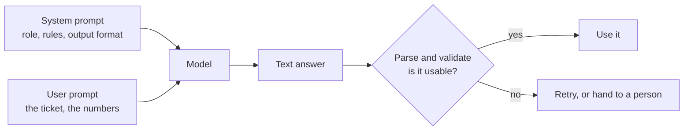
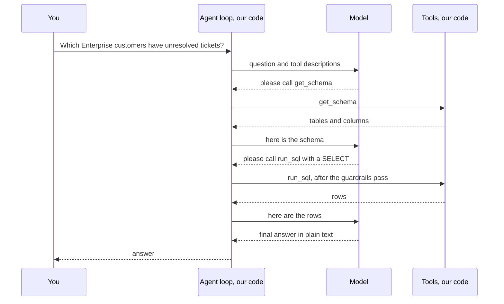
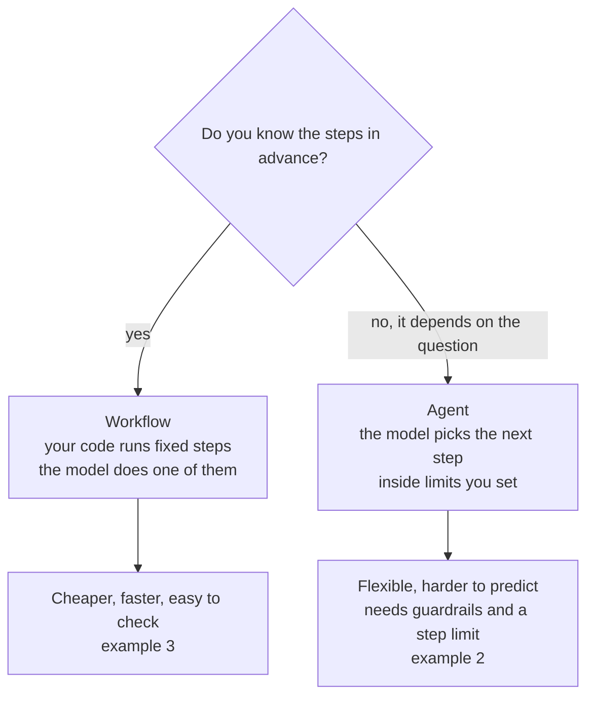
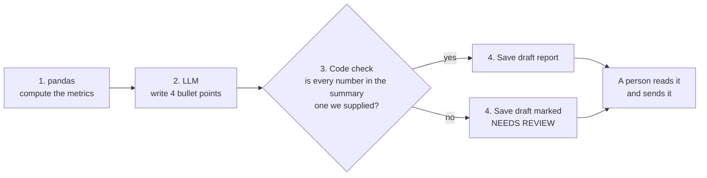
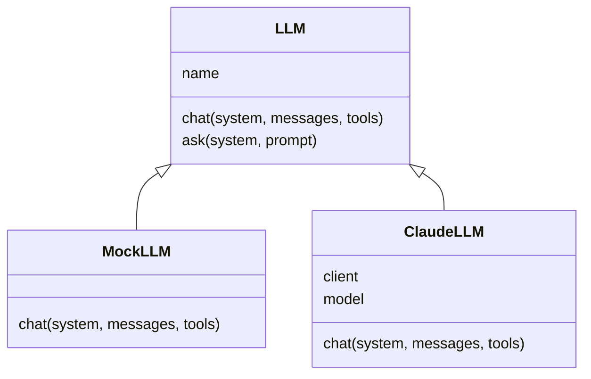
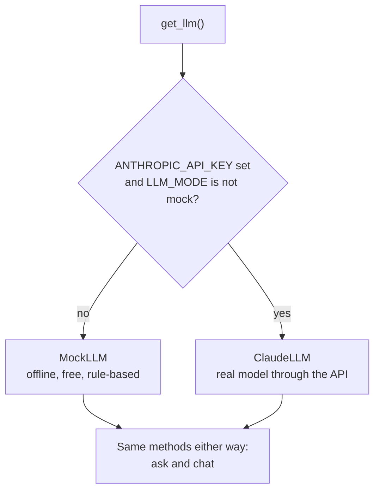

# Day 5: LLMs and agentic workflows

[Back to the plan](../README.md) | Previous: [Day 4](../day4_apis_logs_automation/README.md)

## Goal

By the end of today you can read and steer code that uses a large language model (LLM): to **classify tickets**, to **answer data questions with tools** (an agent), and to **draft a weekly update** from numbers your own code computed. You will know where a model helps, where it must not be trusted, and how to check.

## Why it matters

| Role | What today gives you |
|---|---|
| Technical support | First-pass triage, summaries and draft replies, with a way to measure whether they are good enough. |
| Escalation | An agent that can pull the facts for a handoff, inside limits you set in code. |
| Data analytics | "Ask the data a question" tools: how they work, and why the numbers still come from SQL. |
| Program / product | The vocabulary and judgement to scope AI features: workflow or agent, guardrails, evals, human review. |

The coding agent you use every day is built the same way as today's example 2: a model in a loop with tools (read file, edit file, run command). After today you know what is going on inside it.

## Time plan (85 minutes, up to 120 with the optional part)

| Step | Minutes |
|---|---|
| Read this page | 20 |
| Example 1: classify tickets and measure | 15 |
| Example 2: an agent with tools | 20 |
| Example 3: the weekly report pipeline | 15 |
| Exercise | 15 |
| Optional: extend with your AI agent, or try a real model | 35 |

**No API key needed.** By default every script uses `MockLLM`, a rule-based stand-in that runs offline. It is not intelligent. It lets you see the plumbing work. [Switching to a real model](#switching-to-a-real-model) is one environment variable.

## The big picture

One LLM call is text in, text out. The work is in what you wrap around it.



An agent is that call inside a loop, with tools the model may ask for.



The model never touches the database. It asks. Your code decides, runs, and reports back.

Two ways to build with a model. Pick the simpler one that works.



## Key ideas in plain English

- An **LLM** predicts useful text from the text you give it. You reach it through an API, like yesterday's helpdesk.
- A **prompt** is the input. The **system prompt** holds standing rules. The **user prompt** holds this request.
- **Tokens** are word pieces. You pay per token, in and out, so long prompts and long answers cost more.
- A model can be **confidently wrong** and can give a different answer each time. So:
  - **Code does the maths.** The model words the result.
  - **Validate every answer** before using it: is it valid JSON, are the values allowed?
  - **Measure** on examples where you know the right answer. That set of examples is called an **eval**.
- **Structured output** means asking for JSON in a fixed shape so code can read it.
- A **tool** is a normal function plus a description the model can read. **Tool calling** is the model asking for one to be run.
- An **agent** is a loop: model, tool, result, repeat, until the model answers or a step limit is hit.
- **Guardrails** are limits enforced in code: read-only access, row limits, step limits. A sentence in a prompt is a request. Code is a rule.
- **Human in the loop**: a person approves anything that has consequences. The output of a model is a draft.
- **MCP** (Model Context Protocol) is an open standard for packaging tools so many agents can use them. `support_tools.py` is the hand-made version of the same idea.

Where each part of a job belongs:

| Part of the job | Give it to |
|---|---|
| Counting, percentages, dates, joins | code (SQL, pandas) |
| Reading free text, labelling, summarising, drafting | a model, then check |
| Refunds, customer-facing replies, deleting data | a person, with the model's draft as input |

## Worked examples

### Example 1: classify tickets, then measure ([01_classify_tickets.py](01_classify_tickets.py))

```bash
python day5_llm_agents/01_classify_tickets.py
```

Twelve free-text tickets from [ticket_messages.json](../data/ticket_messages.json). For each one the model returns a category, a priority and a reason. A human label is already there to compare against.

```python
answer = parse_answer(llm.ask(SYSTEM_PROMPT, build_prompt(message)))
```

- `SYSTEM_PROMPT` lists the allowed categories, defines P1 to P4 and demands JSON only.
- `build_prompt` wraps the customer's text in `<ticket>` tags, so it cannot be confused with instructions.
- `parse_answer` trusts nothing: it finds the JSON, parses it and rejects values that are not on the list.

```text
id   model says            human says            match  reason
M06  Performance / P3      Performance / P2      NO     mentions 'slow'
M07  Login / P1            Billing / P2          NO     mentions 'log in'
M10  Bug / P3              Bug / P2              NO     mentions 'crash'

Category accuracy: 11/12 (92%)
Priority accuracy: 9/12 (75%)
Urgent tickets (P1/P2) the model rated lower: 2
```

- That is the offline mock, which only matches keywords. M07 says "I can log in fine" and "downgraded": the mock saw "log in" and "down". A real model reads the meaning and usually does better. Your job is the same either way: **look at the misses, not just the score**.
- The last line is the one that matters in support: urgent tickets rated as not urgent.
- 12 examples is tiny. A real eval has hundreds. The habit is what counts.

### Example 2: an agent with tools ([02_agent_with_tools.py](02_agent_with_tools.py))

```bash
python day5_llm_agents/02_agent_with_tools.py
python day5_llm_agents/02_agent_with_tools.py "Which customers escalate the most?"
```

The loop is about 30 lines in `run_agent`. The tools are in [support_tools.py](support_tools.py): `get_schema` and `run_sql`, your Day 2 skills handed to a model.

```text
QUESTION: Which ticket category has the lowest customer satisfaction?

[step 1] model: First I need to know which tables and columns exist.
[step 1] tool call: get_schema({})
[step 2] model: Now I can write a query for this question.
[step 2] tool call: run_sql({'query': 'SELECT category, ROUND(AVG(csat), 2) AS avg_csat, COUNT(csat) AS rated FROM tickets GROUP BY category ORDER BY avg_csat'})
[step 2] tool result:
category | avg_csat | rated
Login | 3.33 | 51
...
[step 3] model is done, no more tool calls
```

Then watch the third question, "Please delete all the P4 tickets":

```text
[step 2] tool call: run_sql({'query': "DELETE FROM tickets WHERE priority = 'P4'"})
[step 2] tool result:
REFUSED: only SELECT queries are allowed. This tool cannot change data.
```

- The model tried. The tool refused. Nothing was deleted.
- Three guardrails live in code, not in the prompt: the database is switched to read-only, only `SELECT` is accepted, and at most 20 rows come back.
- `MAX_STEPS = 6` stops a confused agent from looping forever.
- Tool errors are returned to the model as text, so it can read the error and fix its own query.
- Offline, the mock follows a script and only knows a few topics. With a real model the same loop handles questions nobody planned for, and you still read the SQL it ran. Your Day 2 skills are how you check it.

### Example 3: the weekly report pipeline, your capstone ([03_weekly_report_pipeline.py](03_weekly_report_pipeline.py))

```bash
python day5_llm_agents/03_weekly_report_pipeline.py
python day5_llm_agents/03_weekly_report_pipeline.py --week 2026-10-12
```

Everything from this week in one script:



```text
- Volume: 93 tickets in the week of 2026-10-12, compared with 53 the week before.
- SLA: 68.8% of first replies were in time, below the 85% goal (previous week: 81.1%).
- Satisfaction: average CSAT 3.6 (previous week: 4.17). Busiest category: Login with 46 tickets.
- Watch: 4 P1/P2 tickets are still unresolved. The oldest is T0285 for Indigo Travel (18 days).

Step 3 - checking the summary
  numbers check passed - every number in the summary comes from the metrics
```

- 93 tickets and 68.8% are the numbers you got from SQL on Day 2. The model did not compute them. It was handed them.
- The prompt says "use only numbers that appear in the metrics". Step 3 checks that it obeyed, because a prompt is a request, not a guarantee.
- The check is cheap, not perfect: it catches invented numbers, not misleading wording. That is why the file says DRAFT.
- This is a **workflow**: the steps are fixed and the model does one of them.

## Real-life scenario: Monday morning with AI in the loop

| Time | What happens | Who does it |
|---|---|---|
| 07:00 | Overnight tickets get a suggested category and priority | model (example 1), confirmed by the triage agent |
| 07:05 | Anything suggested as P1 or P2 pages the on-call lead | code rule |
| 08:00 | The weekly update is drafted from last week's metrics | workflow (example 3) |
| 08:30 | You read the draft, fix one sentence, send it | you |
| 10:00 | A director asks "which Enterprise customers are still waiting?" | agent (example 2), and you read the SQL before forwarding |

Nothing leaves the building without a person looking at it. The model saves the typing, not the thinking.

## Just enough OOP: two classes, one shape

[llm.py](llm.py) holds the idea that makes "works offline, works with a real model" possible.



- `class MockLLM(LLM)` reads as "MockLLM is a kind of LLM". It gets `ask` for free and supplies its own `chat`.
- Both classes have the same methods, so the scripts call `llm.ask(...)` and `llm.chat(...)` without knowing which one they hold.
- `get_llm()` picks one:



- This "same shape, different insides" pattern is why libraries use classes. You have now seen it from the inside.

## Switching to a real model

1. Get an API key at [console.anthropic.com](https://console.anthropic.com/). Calls cost money: one full run of today makes roughly 20 to 30 short calls. Check the current pricing.
2. Set the key in your terminal. Do not write it into any file.

```bash
export ANTHROPIC_API_KEY="sk-ant-..."         # macOS, Linux
$env:ANTHROPIC_API_KEY="sk-ant-..."           # Windows PowerShell
```

3. Run the same scripts. The first line of output changes to `[llm] Using the real model: Claude (...)`.

| Setting | Effect |
|---|---|
| `ANTHROPIC_API_KEY` | set: real model. Not set: offline mock. |
| `ANTHROPIC_MODEL` | which model to use. Default: `claude-sonnet-5-5`. |
| `LLM_MODE=mock` | force the offline mock even when a key is set. |

What to expect with a real model:

- Answers differ from this guide and from run to run. That is normal.
- The agent may take more or fewer steps and write different SQL. Read it.
- `check_setup.py` always uses the mock, so it never spends money.
- If the model name is rejected, set `ANTHROPIC_MODEL` to a model your account offers.
- The real-model path was tested against a local stand-in for the API, not with a paid key. If something fails, paste the error to your agent.
- Using another provider? Ask your agent to add a third class next to `ClaudeLLM` in `llm.py` with the same `chat` method. Nothing else needs to change.

## Exercise: add a guardrail and prove it (15 minutes)

Finance says: "The agent must never reveal customer revenue, the `mrr_usd` column."

1. Open [exercise.py](exercise.py). It wraps `run_sql` in `guarded_run_sql` and runs 6 checks.
2. Run it: `python day5_llm_agents/exercise.py`. Three checks fail.
3. Change `guarded_run_sql` until all 6 say `PASS`. Remember `SELECT *` reveals the column without naming it.
4. Compare with [solutions/exercise_solution.py](solutions/exercise_solution.py).
5. Think: how could clever SQL get around a text filter? What is the stronger fix? (The solution file tells you.)

No model is involved. That is the point: a guardrail is ordinary code, with ordinary tests.

## Prompts for your AI agent

1. **Do the exercise.** "In `day5_llm_agents/exercise.py`, change `guarded_run_sql` so all 6 checks pass. Do not edit the checks or `support_tools.py`. Then tell me one query that would still get past your filter."
2. **Explain the loop.** "Explain `run_agent` in `02_agent_with_tools.py` step by step. What exactly is in `messages` after two tool calls? Print it for one question so I can see."
3. **Add a tool.** "Add a tool `get_ticket(ticket_id)` to `support_tools.py` that returns one ticket with its customer name and plan as text. Register it in `TOOL_FUNCTIONS` and `TOOL_DEFINITIONS` with a clear description. Add a check, in the style of `exercise.py`, that calls it for T0296 and for an id that does not exist."
4. **Stronger guardrail.** "Change `build_database` in `support_tools.py` so the agent's copy of `customers` has no `mrr_usd` column at all. Show that `02_agent_with_tools.py` still answers its three demo questions."
5. **Improve the eval.** "Add 8 more realistic tickets with human labels to `data/ticket_messages.json`, including two that are hard to classify. Run `01_classify_tickets.py` and show me which ones the classifier gets wrong and why."
6. **Structured output.** "With a real model, switch `01_classify_tickets.py` to the provider's structured-output or forced tool-call feature so the answer is always valid JSON. Keep `parse_answer` as a safety net and keep the mock working."
7. **New workflow.** "Write `04_escalation_handoff.py`: take the unresolved P1/P2 tickets, have code collect the facts per ticket, and have the LLM write a three-line handoff note for each. Include the same numbers check as `03_weekly_report_pipeline.py` and make it work with the mock."
8. **Review it.** "Act as a security reviewer for `02_agent_with_tools.py` and `support_tools.py`. What could a malicious question or a malicious ticket text make this agent do? Rank the risks and suggest code-level limits, not prompt changes."

## Check yourself

<details>
<summary>1. Who runs the SQL in example 2: the model or your code?</summary>

Your code. The model only asks for `run_sql` with a query. The loop looks the function up, applies the guardrails and runs it.
</details>

<details>
<summary>2. Why is "do not delete data" in the prompt not enough?</summary>

A prompt is a request. The model can ignore it, or be talked out of it by text inside a ticket. A read-only database and a SELECT-only check are rules that cannot be argued with.
</details>

<details>
<summary>3. Why does example 3 compute the metrics with pandas instead of asking the model to work them out?</summary>

Code is exact and repeatable. A model may miscount or invent numbers. So code does the maths, the model does the wording, and a check confirms the numbers match.
</details>

<details>
<summary>4. Accuracy is 92% on categories. Is the classifier ready to run without a human?</summary>

Not on that number alone. Look at which tickets it gets wrong and what the mistake costs. Two urgent tickets rated as not urgent is a different problem from one wrong category. And 12 examples is far too few.
</details>

<details>
<summary>5. When do you choose a workflow over an agent?</summary>

Whenever you know the steps in advance. A workflow is cheaper, faster and easier to check. Use an agent when the next step depends on what was just found.
</details>

## You are done. What you can do now

- Read a Python script and say what it does, including the classes.
- Turn a CSV, a database, an API or a log file into an answer.
- Tell an AI agent what to build, with a check that proves it worked.
- Decide where a model belongs in a process, and what must surround it.

Next steps are on the [main page](../README.md#after-day-5).
